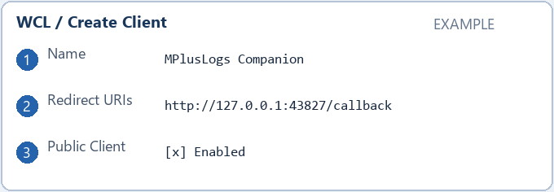
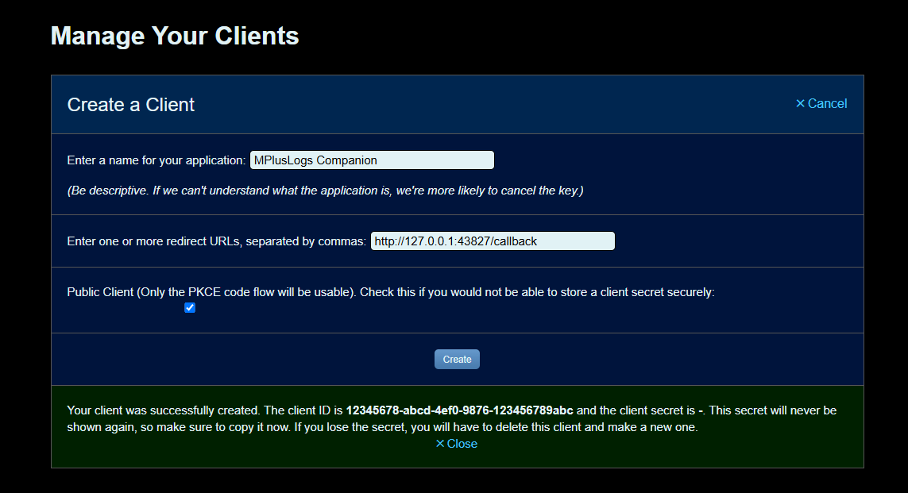

# MPlusLogs

Companion reuses dual DPS/HPS profiles for 24 hours, caches valid missing-log
responses for six hours, and persists its API budget across restarts. Companion
connects directly to Warcraft Logs through a personal or shared API client.
The profile cache is isolated by WCL account and API client and survives token
refreshes and signing back into the same account. Existing sessions resolve their
account once after upgrading; profiles then populate the new account cache as
requested. Automatic reads reuse this cache. The explicit **Update M+ logs**
button fetches fresh WCL data once five minutes have passed since the last
successful request for that character and specialization. Cache reads and
requests for other profiles do not restart this timer.

Mythic+ Warcraft Logs DPS/HPS profiles for WoW group recruitment, with a Windows Companion.

## Install

The installer uses `%LOCALAPPDATA%\Programs\MPlusLogs Companion` by default.
Companion may also live directly in `Interface\AddOns` or in its own separate
folder. Do not place it inside an individual addon folder such as
`AddOns\MPlusLogs`: an addon update can remove those files. Reinstalling always
offers a directory selection, including when the previous files are missing.

Install the addon from [CurseForge](https://www.curseforge.com/wow/addons/mpluslogs).
**REQUIRED: Install and run MPlusLogs Companion on Windows. Online log loading does not work without it.**
Download the [current MPlusLogs Companion installer for Windows](https://github.com/indrih17/MPlusLogs/releases/download/companion-channel/MPlusLogs-Companion-Setup.exe)
and run the Setup exe. This permanent link is updated whenever a new Companion
version is published. Windows 10/11 x64;
no separate Python installation is needed. The Companion supports all WoW client languages; select one in Settings > Language.

The installer is the recommended option and updates through Setup. Alternatively,
download the [portable ZIP for Windows](https://github.com/indrih17/MPlusLogs/releases/download/companion-channel/MPlusLogs-Companion-Portable.zip),
extract the entire folder, and run `MPlusLogs-Companion.exe`. Keep `_internal`
beside the EXE. Both download links always point to the current release.
The portable version updates its own files from a verified ZIP and rolls back
if replacement or the new runtime's self-test fails. It does not run Setup or
register an installed application. Both versions share login and settings in
AppData and support optional startup with Windows or WoW Retail. Re-enable
startup after manually moving a portable folder.

### Установка — русский

Рекомендуемый вариант — [установщик Companion](https://github.com/indrih17/MPlusLogs/releases/download/companion-channel/MPlusLogs-Companion-Setup.exe).
Он устанавливает программу и обновляет её через Setup.
Также доступна [portable версия в ZIP](https://github.com/indrih17/MPlusLogs/releases/download/companion-channel/MPlusLogs-Companion-Portable.zip):
распакуйте папку целиком и запустите `MPlusLogs-Companion.exe`, оставив `_internal`
рядом. Обновление portable версии заменяет её файлы без установщика; при ошибке
замены или самопроверки восстанавливается предыдущая версия.
Оба варианта сохраняют вход и настройки в AppData и поддерживают автозапуск
с Windows или WoW Retail. После ручного переноса папки portable включите
автозапуск заново из нового расположения. Не размещайте Companion внутри папки
отдельного аддона, например `AddOns\MPlusLogs`.

Sign in through Warcraft Logs in the Companion. In WoW, right-click an applicant
or open `/mpl`, request their M+ logs, press Ctrl+C, wait, then press Ctrl+V.
Use `/mpl demo` for a fictional preview without an account.

The addon supports eleven locales, player panels, recruitment tooltips,
dual DPS/HPS profiles, batch candidate loading, stale-data indicators and manual import.
Recruitment tooltips highlight the listed dungeon with its Best/Median percentiles,
the key level of the best logged result, and the logged-run count. Specialization
profiles are stored separately. When WoW supplies an applicant's specialization,
MPlusLogs requests that specialization; otherwise it uses an explicitly labeled
All Specs profile. Use the specialization selector in the profile window to switch
between saved profiles or choose **Load other specializations** for that player.
DPS is shown first for every role, including healers; full profiles use Warcraft Logs-style tables with dungeon icons and DPS/HPS tabs. HPS also remains available in tooltips.
Customize healer HPS priority, Best avg/Median priority, freshness (6/12/24/48 hours),
tooltips and stale-log alerts in Settings > AddOns > MPlusLogs, or use `/mpl settings`.
Changes apply immediately and are saved between sessions.
Percentiles describe available Warcraft Logs runs. They do not measure tank survival.

## Code signing policy

See our [Code signing policy](CODE-SIGNING.md) for the current signing status,
responsible maintainer and approval process. Official downloads are currently
unsigned; a SignPath application has been submitted and is awaiting review.

## Privacy policy

The Companion sends only MPlusLogs request envelopes to Warcraft Logs.
Unrelated clipboard text is not transmitted. It does not read game memory or
automate gameplay. Login uses browser OAuth with PKCE; local tokens are protected
with Windows DPAPI. Startup with Windows or WoW Retail is optional. Response sounds are enabled by default and can be disabled in Settings.
Settings, tokens, cache and recent results are stored in `%LOCALAPPDATA%\MPlusLogs`.
Sign out to remove saved tokens; uninstall preserves local data.

Replies are marked to stay out of Windows clipboard history and cloud sync.
When Windows permits history access, Companion removes only exact copies of
requests it has processed. Other history entries are preserved; history text
is not logged or transmitted. This does not clear older, unprocessed requests.

Companion contacts Warcraft Logs for browser authorization, token refresh and
the character/profile requests explicitly initiated through MPlusLogs. It sends
the requested character name, realm, region and filters, with the WCL access
token. The local browser callback is bound to 127.0.0.1; a WCL password is never
entered into Companion. See [Warcraft Logs Privacy Policy](https://www.warcraftlogs.com/help/privacy).

Companion also checks GitHub for update metadata at startup and daily,
and downloads an available installer or portable ZIP to a temporary folder. Applying an update needs
the user's action. Update requests do not include WCL tokens, clipboard text,
character profiles or user settings. Standard network requests expose the client
IP address and request headers to the contacted service. See
[GitHub General Privacy Statement](https://docs.github.com/en/site-policy/privacy-policies/github-general-privacy-statement).

MPlusLogs has no analytics or telemetry uploader. Clipboard entries unrelated to
an MPlusLogs request are not uploaded. Local cache and diagnostic files remain on
the computer unless the user chooses to share them. WCL sign-in/profile loading
and Companion's update checks require network access; `/mpl demo` is available
without a WCL account.

## Personal API — recommended

Click **Set up personal API** in Companion. If you already signed in with the
author's shared client, click **Switch to personal API**. The shared allowance
is used by everyone who selects that client.

1. Open [WCL clients](https://www.warcraftlogs.com/api/clients), sign in and choose **Create Client**.
2. Enter Name `MPlusLogs Companion`, Redirect URIs `http://127.0.0.1:43827/callback`, and enable **Public Client**. Click **Create**. Companion has copy buttons for both fields.
3. Copy your new **Client ID**, paste it into Companion and click **Connect and check**. Finish authorization in your browser. **Client Secret is not needed.**





These are explanatory diagrams with a fictional ID, not account screenshots.
The previous connection stays available if setup fails or is cancelled.
WCL assigns each client's allowance; Companion displays the actual points and
reset time returned by WCL during login and log loading. It does not silently
fall back to the shared client when your personal allowance runs out.
The addon shows a countdown to the selected client's WCL reset in quota errors.
If WCL has not provided a reset time, it says so instead of guessing.

## Build and test

Requires Python 3.12 on Windows with tkinter and Inno Setup 6.

```powershell
python -m pip install pyinstaller==6.22.0 lupa Pillow
python -m unittest discover -s tests -q
python tools/build_release.py --iscc "C:\Program Files (x86)\Inno Setup 6\ISCC.exe"
```

Output: `release-output/`, including SHA-256 checksums. The script packages only
TOC-referenced addon files and bundled dungeon icons, excludes local logs/tokens/cache, and removes the
development character snapshot from the shipped addon. The source snapshot is
a development test fixture. Frozen resources are checked without account access.
Release binaries are currently unsigned.

Companion starts its own version series at 1.0.0; the addon keeps its 0.x series.
Each component advances only when its shipped files change. Companion-only
releases do not create addon updates on CurseForge. The installed version
downloads a verified Setup EXE; the portable version downloads a verified ZIP.
Both offer the same update-and-restart action and preserve login, settings and
startup choices. Older portable copies without ZIP update support need to be
replaced with the current portable download once.

Every push to `main` runs the Windows tests and builds the addon. Companion binaries are built and released only when its shipped inputs change. The workflow
publishes GitHub Release assets and uploads the addon to CurseForge with changelog.
Direct source commits automatically raise the patch version if needed.
CurseForge moderation must still approve the upload.

For the live addon folder, `tools/publish_changes.py --summary "Describe change"`
runs tests, raises the patch version, writes CHANGELOG.md and pushes an allowlisted
snapshot. A Codex heartbeat checks finished local edits every 15 minutes.

See [LICENSE](LICENSE) for usage terms. Bundled third-party components retain their licenses.
